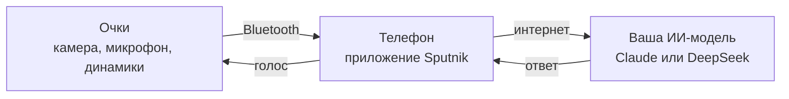

# Sputnik — ИИ для очков Ray-Ban Meta

## Зачем это

Очки Ray-Ban Meta умеют снимать, слушать и говорить, но вся «умная» часть в них — помощник Meta AI. Он работает не во всех странах. Там, где его нет, очки превращаются в камеру и Bluetooth-наушники.

**Задача проекта — вернуть очкам искусственный интеллект, подключив вашу любимую ИИ-модель.** Sputnik — бесплатное приложение для Android с открытым кодом. Оно соединяет очки с моделью, которую выбрали вы (Claude или DeepSeek):

- вы спрашиваете голосом — ответ звучит прямо в очках;
- показываете очками, что перед вами, — модель описывает, читает, переводит;
- разговариваете с иностранцем — приложение переводит в обе стороны.

> Sputnik — независимый проект. Он не связан с Meta, Ray-Ban, Anthropic или DeepSeek; их названия — товарные знаки владельцев.

---

## Что умеет

**Помощник в чате**
- **Вопрос голосом или текстом.** Коротко ответ звучит в очках, подробности — в чате под кнопкой «Подробнее».
- **«Что я вижу».** Очки делают снимок, модель рассказывает, что перед вами: вывеска, блюдо, достопримечательность, прибор.
- **«Переведи, что вижу».** Перевод меню, вывесок и табличек. Цены сразу пересчитываются в вашу валюту по курсу ЦБ.
- **Поиск в интернете** (с Claude) — для свежих данных: часы работы, расписания, новости. Под ответом — ссылки на источники.
- **«Запомни…»** — заметка с фото и местом: «Запомни, машина на третьем уровне». Потом: «Где я оставил машину?»
- **Календарь** — «Добавь в календарь встречу завтра в 10»: откроется окно календаря с готовым событием.
- **Профили**: Путешественник, Исследователь, Инженер, Разработчик — у каждого свой характер ответов, его можно поправить под себя.
- **Стиль общения**: кратко, подробно, дружески, по-деловому, как экскурсовод, простыми словами — и своё пожелание.

**Переводчик**
- Живой перевод разговора с собеседником: английский, китайский, турецкий, немецкий, французский, испанский, итальянский, арабский, тайский.
- Учитывает вежливость и ваш пол (например, тайские ครับ / ค่ะ).
- «Показать» — фраза крупно на весь экран, чтобы собеседник прочитал.

**Навигация**
- «Мои места»: отель, дом, машина и свои — с фото входа.
- «Куда?» — найти место и открыть маршрут в Яндекс Картах, Google Картах или Organic Maps.
- **Компас с голосом**: «Прямо 300 метров… вы на месте» — можно идти, не доставая телефон.
- **Карточка для таксиста**: адрес крупно на местном языке, кнопка «Произнести».
- Советы по общественному транспорту.

**Очки**
- **Жест на дужке**: двойное касание — вопрос, даже когда экран погашен и приложение закрыто. Касание во время ответа — перебить.
- **Видео с очков без ограничения по времени** (до 720p): **☰ → «Медиа» → «Видео»**, запись идёт и с погашенным экраном, куски по 10 минут сохраняются в галерею.

**Безопасность**
- Ссылки и QR-коды со снимков **никогда не открываются сами**: приложение показывает настоящий адрес сайта и предупреждает о подделках.
- API-ключи хранятся только на вашем телефоне, в зашифрованном виде.
- Если Claude недоступен, ответит запасная модель DeepSeek (если ключ к ней добавлен).

---

## Что понадобится

| Что | Подробности |
| --- | --- |
| Очки | Ray-Ban Meta Gen 2 (на них приложение проверено). Должны подойти и другие очки Meta, которые поддерживают Wearables Device Access Toolkit. |
| Телефон | Android 10 или новее, 64-битный (почти все телефоны последних лет). |
| Приложение Meta AI | Из Google Play — через него очки подключаются к телефону. |
| Аккаунт Meta | Для входа в Meta AI. |
| API-ключ ИИ | Claude или DeepSeek — как получить, ниже. |
| Интернет | Для ответов модели. |

---

## Установка за 6 шагов

### Шаг 1. Подключите очки к Meta AI

1. Установите **Meta AI** из Google Play и войдите в аккаунт Meta (или создайте его).
2. Нажмите «добавить очки» и следуйте подсказкам: снимите защитную плёнку, положите очки в футляр — индикатор на футляре загорится синим.
3. Когда Meta AI предложит обновить очки — обновите. Очки при этом лежат в футляре на зарядке рядом с телефоном.

### Шаг 2. Включите режим разработчика

Sputnik не продаётся в магазине Meta, поэтому очкам нужно разрешить работать с ним напрямую.

1. В Meta AI откройте **Настройки → App info** (сведения о приложении).
2. **Пять раз нажмите на номер версии** (App version) — появится переключатель **Developer Mode**.
3. Включите его и подтвердите кнопкой **Enable**.
4. Ниже появятся ваши очки с надписью «DAT SDK version: Not installed». Нажмите **Install** и дождитесь зелёной точки и номера версии.

### Шаг 3. Установите Sputnik

- **Готовый файл:** скачайте последний APK со страницы [Releases](../../releases) этого репозитория, откройте его на телефоне и разрешите установку из этого источника.
- **Или соберите сами** — см. раздел «Для разработчиков» в конце.

### Шаг 4. Первый запуск

1. Прочитайте и примите пользовательское соглашение.
2. Выберите модель (Claude или DeepSeek) и вставьте API-ключ — как его получить, написано в следующем разделе. Можно нажать «Пропустить» и добавить ключ позже.
3. Разрешите доступ к микрофону и к Bluetooth-устройствам («Устройства поблизости»). Камеру, местоположение и календарь приложение спросит, когда они впервые понадобятся.

### Шаг 5. Подключите очки к Sputnik

1. В Sputnik откройте меню **☰ → «Очки»** и нажмите **«Подключить очки»**.
2. Откроется Meta AI — подтвердите подключение и вернитесь в Sputnik.
3. В первый раз, когда вы скажете «Что я вижу», Meta AI попросит доступ к камере очков — разрешите.

Проверить подключение можно в Meta AI: **Настройки → App connections → Developer mode apps** — там должен быть Sputnik.

### Шаг 6. Чтобы телефон не «усыплял» приложение

На Samsung: **Настройки → Батарея → Ограничения фонового использования → «Приложения, которые никогда не переходят в спящий режим»** — добавьте туда **Meta AI** и **Sputnik**. На других телефонах похожий пункт называется «Без ограничений» или «Не оптимизировать».

---

## API-ключ: что это и где взять

**API-ключ** — это личный пароль, по которому модель понимает, что запрос от вас, и списывает плату с вашего баланса. Платите только за свои вопросы — по факту, без подписки. Сколько потрачено, видно в Sputnik: **Настройки → «Расходы по API»**.

### Какую модель выбрать

| | Claude (Anthropic) | DeepSeek |
| --- | --- | --- |
| Сильная сторона | Сложные вопросы, точность | Скорость и цена |
| Видит фото («Что я вижу») | Да | Да (модель Flash) |
| Поиск в интернете | Да | Нет |
| Цена | Дороже | Дешевле |

Claude доступен только в [странах, которые поддерживает Anthropic](https://www.anthropic.com/supported-countries). Можно добавить оба ключа: тогда при сбое Claude ответит DeepSeek.

### Ключ Claude

1. Откройте [console.anthropic.com](https://console.anthropic.com) и зарегистрируйтесь.
2. Пополните баланс в разделе **Billing**.
3. Откройте **API Keys → Create Key**, назовите ключ, например, «Sputnik».
4. **Сразу скопируйте ключ** (начинается с `sk-ant-`) — полностью его покажут только один раз.

### Ключ DeepSeek

1. Откройте [platform.deepseek.com](https://platform.deepseek.com) и зарегистрируйтесь.
2. Пополните баланс на странице **Top up**.
3. Откройте **API keys → Create new API key**.
4. **Сразу скопируйте ключ** (начинается с `sk-`).

### Как добавить ключ в Sputnik

**☰ → ⚙️ Настройки → «ИИ-ассистенты»** → выберите провайдера → вставьте ключ → **«Проверить и сохранить»**. Проверка бесплатная: приложение только спрашивает у провайдера список моделей.

### Как не потерять деньги

- **Никому не показывайте ключ** и не отправляйте его в чаты. Если ключ утёк — удалите его на сайте провайдера и создайте новый.
- Поставьте **лимит расходов** в кабинете провайдера и не включайте автопополнение.
- Ключ хранится только на вашем телефоне, зашифрованным (Android Keystore), и не попадает в резервные копии. Разработчик его не видит.

---

## Голосовые функции: как включить

### Ответы голосом

Ответы звучат в очках, когда очки подключены к телефону по Bluetooth. Без очков и наушников ответ приходит текстом — его можно прослушать кнопкой **«Озвучить»**.

Какой микрофон слушает ваш голос: **☰ → «Очки» → «Микрофон для моего голоса»**. «Авто» — очки, если подключены, иначе телефон.

### Жест на дужке — вопрос без рук

1. **☰ → «Очки» → «Жест на дужке — вопрос»** — включите.
2. Выберите жест: **«Двойное касание»** (по умолчанию, реже срабатывает случайно) или «Одно касание».

Как пользоваться:
- **Коснитесь дужки** → короткий сигнал «слушаю» → задайте вопрос → ответ звучит в очках.
- Промолчали 5 секунд — сигнал «отбой», вопрос не отправляется.
- **Во время ответа любое касание его перебивает.**
- Работает при погашенном экране и даже после закрытия приложения. Пока жест включён, в шторке висит уведомление «Ассистент готов» — кнопка **«Выключить»** там же.

Важно:
- Пока играет музыка другого приложения (и минуту после неё), касание остаётся паузой музыки.
- После перезагрузки телефона один раз откройте Sputnik — до этого жест не работает (так устроен Android).
- Свайп, удержание дужки и кнопка съёмки остаются за Meta.

### Голосовые команды

| Скажите | Что произойдёт |
| --- | --- |
| «Что я вижу?» | Снимок очками и ответ о том, что перед вами |
| «Переведи, что вижу» | Перевод текста вокруг, цены — в вашей валюте |
| «Запомни, …» | Заметка с фото и местом |
| «Новый разговор» / «Забудь всё» | Начать разговор заново |
| «Веди в отель» / «Как добраться до …» | Маршрут или компас |
| «Как вернуться?» | Обратно в отель (или домой) |
| «Сколько осталось?» | Расстояние до цели |
| «Покажи адрес таксисту» | Карточка для водителя |
| «Где машина?» | Путь к сохранённой машине |
| «Запомни, это мой отель» / «Здесь машина» | Сохранить место |

### Голосовое «стоп»

**Настройки → «Голос и звук» → «Голосовое «стоп» во время ответа»**. Скажите «стоп» — ответ прервётся. Пока функция включена, ответ звучит в очках с качеством телефонного звонка: так устроен Bluetooth — микрофон и качественный звук одновременно не работают.

Там же — **скорость речи** (медленнее / обычно / быстрее), а в **Настройки → «Личные» → «Стиль общения»** — как ассистент отвечает.

### «Hey Meta, start Sputnik» — для продвинутых

Запуск приложения голосовой командой Meta работает только там, где Meta открыла эту функцию (например, в России — нет), и только со своим проектом в Meta:

1. На [wearables.developer.meta.com](https://wearables.developer.meta.com) создайте проект.
2. В **Configuration** укажите пакет `ru.vasev.glasses` и, если есть такое поле, отпечаток ключа подписи вашей сборки (SHA-256).
3. Имя приложения — **Sputnik** (его вы и будете произносить), в **Permissions** включите камеру, микрофон и Voice Invocation.
4. Создайте версию, добавьте её в Beta-канал и пригласите туда свой аккаунт Meta.
5. Впишите `mwdat.applicationId` и `mwdat.clientToken` проекта в `local.properties` (образец — `local.properties.example`) и соберите приложение заново.

---

## Если что-то не работает

| Проблема | Что сделать |
| --- | --- |
| «Подключить очки» не срабатывает | Проверьте в Meta AI: включён Developer Mode, у очков зелёная точка (DAT SDK установлен), очки на связи. |
| Ответ пришёл текстом, без голоса | Очки подключены по Bluetooth? Проведите пальцем вперёд по дужке — это громкость. |
| Жест не срабатывает | Не играет ли музыка? Открывали ли Sputnik после перезагрузки? Добавлено ли приложение в исключения батареи (шаг 6)? |
| «Ключ не подходит» | Ключ скопирован целиком? Есть ли деньги на балансе у провайдера? |
| «Claude недоступен» | Возможно, ваша страна не поддерживается Anthropic — используйте DeepSeek. |

---

## Что и куда отправляется

- **Модели ИИ** (Claude или DeepSeek) получают ваш вопрос и, если вы попросили, снимок. Снимки отправляются без метаданных (EXIF, GPS). У каждого провайдера свои правила хранения данных — например, DeepSeek хранит их в Китае.
- **Только на телефоне** остаются: API-ключи (зашифрованы), история чатов, заметки, места, снимки и видео.
- Своей статистики приложение не собирает; телеметрия Meta Wearables выключена.
- ИИ может ошибаться. Не полагайтесь на него в вопросах здоровья, денег и безопасности и не пользуйтесь приложением за рулём.

Полный текст — в пользовательском соглашении (в приложении: «О приложении»).

---

## Для разработчиков

- Kotlin, Jetpack Compose, Meta Wearables Device Access Toolkit 1.0.1, Anthropic Java SDK, OkHttp, ML Kit, CameraX.
- Сборка: Android Studio (JDK — встроенный JBR), затем `./gradlew assembleDebug`. Тесты: `./gradlew testDebugUnitTest`.
- Без `local.properties` приложение собирается для режима разработчика Meta AI — для обычной работы этого достаточно. Свои идентификаторы Meta нужны только для «Hey Meta» (см. выше).
- Устройство проекта, решения и подводные камни — в [CLAUDE.md](CLAUDE.md) (на русском). Приложение написано с помощью [Claude Code](https://claude.com/claude-code).
- Вопросы и ошибки — через [Issues](../../issues).

## Лицензия

Код открыт по лицензии MIT: его можно свободно использовать, изменять и распространять, сохраняя указание автора — **vav79**. Подробнее — в файле [LICENSE](LICENSE).
